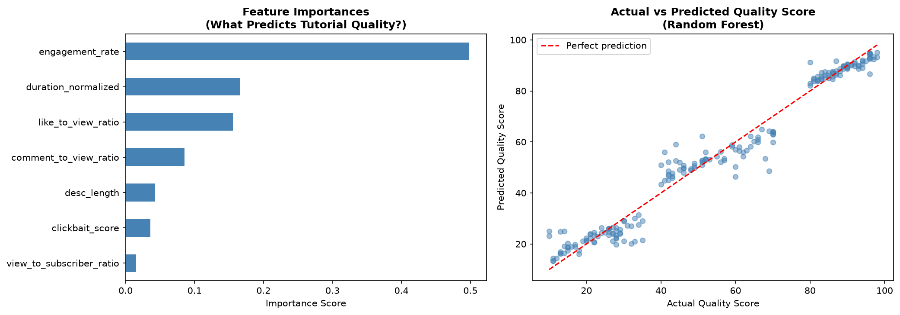

# Tutorial Quality Scorer

A completed educational regression exercise that scores coding-tutorial metadata using a Random Forest and compares it with linear regression. The included **200-row dataset is synthetic**; its scores are supplied labels, not independently measured teaching quality.

## Run it

```bash
git clone https://github.com/CodeAcc2007-dev/tutorial-quality-scorer.git
cd tutorial-quality-scorer
python -m venv .venv
source .venv/bin/activate
python -m pip install -r requirements.txt
python scorer.py
```

Run from the repository root. For a headless session, use `MPLBACKEND=Agg python scorer.py`.

The script prints holdout MAE/R², five-fold cross-validation MAE, feature importances, and example explanations. It writes `scored_tutorials.csv` and `model_analysis.png`.

## How it works

Seven features combine engagement ratios, title-pattern counts, description length, normalized duration, and views per subscriber. An 80/20 split with seed 42 evaluates a 100-tree Random Forest against a linear baseline. Cross-validation checks stability on the same synthetic dataset.

| File | Purpose |
|---|---|
| [scorer.py](scorer.py) | Feature engineering, models, evaluation, and explanations |
| [tutorials.csv](tutorials.csv) | Synthetic input data and provided quality labels |
| [scored_tutorials.csv](scored_tutorials.csv) | Sorted model scores for all supplied examples |
| [model_analysis.png](model_analysis.png) | Feature importances and fitted predictions |
| [results.json](results.json) | Recorded metrics and input/output hashes |



## What the results establish

The model learns patterns in the synthetic labels. It does not watch the videos, assess factual correctness, or measure real learning outcomes. Likes, duration, and title wording are proxy signals and cannot establish actual tutorial quality. The scores for all 200 rows mix training and held-out rows; the printed holdout metrics and cross-validation result are the evaluation, not the full-data scatterplot.

The original exercise was WnCC Convenor Assignment 2026–27, Question 3. The source algorithm is preserved; this public package adds portable dependencies, explicit data provenance, and reproducibility notes.
